  <picture>
    <source media="(prefers-color-scheme: dark)" srcset="./assets/hero-dark.svg" />
    <source media="(prefers-color-scheme: light)" srcset="./assets/hero-light.svg" />
    
  </picture>

  

  
  
  

  <picture>
    <source media="(prefers-color-scheme: dark)" srcset="./assets/divider-dark.svg" />
    <source media="(prefers-color-scheme: light)" srcset="./assets/divider-light.svg" />
    
  </picture>

### ✦ Featured Projects

| | |
| :---: | :---: |
| <a href="https://github.com/aboveproof/BadgeFarmer"><picture><source media="(prefers-color-scheme: dark)" srcset="https://github-stats-extended.vercel.app/api/pin/?username=aboveproof&repo=BadgeFarmer&bg_color=0d1117&border_color=30363d&title_color=58a6ff&icon_color=a371f7&text_color=c9d1d9&border_radius=10" /><source media="(prefers-color-scheme: light)" srcset="https://github-stats-extended.vercel.app/api/pin/?username=aboveproof&repo=BadgeFarmer&bg_color=ffffff&border_color=d0d7de&title_color=0969da&icon_color=8250df&text_color=24292f&border_radius=10" /></picture></a> | <a href="https://github.com/aboveproof/Vela"><picture><source media="(prefers-color-scheme: dark)" srcset="https://github-stats-extended.vercel.app/api/pin/?username=aboveproof&repo=Vela&bg_color=0d1117&border_color=30363d&title_color=58a6ff&icon_color=a371f7&text_color=c9d1d9&border_radius=10" /><source media="(prefers-color-scheme: light)" srcset="https://github-stats-extended.vercel.app/api/pin/?username=aboveproof&repo=Vela&bg_color=ffffff&border_color=d0d7de&title_color=0969da&icon_color=8250df&text_color=24292f&border_radius=10" /></picture></a> |
| <a href="https://github.com/aboveproof/nighty-docs"><picture><source media="(prefers-color-scheme: dark)" srcset="https://github-stats-extended.vercel.app/api/pin/?username=aboveproof&repo=nighty-docs&bg_color=0d1117&border_color=30363d&title_color=58a6ff&icon_color=a371f7&text_color=c9d1d9&border_radius=10" /><source media="(prefers-color-scheme: light)" srcset="https://github-stats-extended.vercel.app/api/pin/?username=aboveproof&repo=nighty-docs&bg_color=ffffff&border_color=d0d7de&title_color=0969da&icon_color=8250df&text_color=24292f&border_radius=10" /></picture></a> | <a href="https://github.com/aboveproof/nighty-docs-mcp"><picture><source media="(prefers-color-scheme: dark)" srcset="https://github-stats-extended.vercel.app/api/pin/?username=aboveproof&repo=nighty-docs-mcp&bg_color=0d1117&border_color=30363d&title_color=58a6ff&icon_color=a371f7&text_color=c9d1d9&border_radius=10" /><source media="(prefers-color-scheme: light)" srcset="https://github-stats-extended.vercel.app/api/pin/?username=aboveproof&repo=nighty-docs-mcp&bg_color=ffffff&border_color=d0d7de&title_color=0969da&icon_color=8250df&text_color=24292f&border_radius=10" /></picture></a> |

  <picture>
    <source media="(prefers-color-scheme: dark)" srcset="./assets/divider-dark.svg" />
    <source media="(prefers-color-scheme: light)" srcset="./assets/divider-light.svg" />
    
  </picture>

### ✦ Telemetry & Languages

  <picture>
    <source media="(prefers-color-scheme: dark)" srcset="https://github-stats-extended.vercel.app/api?username=aboveproof&rank_icon=percentile&hide_title=true&show_icons=true&include_all_commits=true&bg_color=0d1117&border_color=30363d&title_color=58a6ff&icon_color=a371f7&text_color=c9d1d9&ring_color=58a6ff&border_radius=10" />
    <source media="(prefers-color-scheme: light)" srcset="https://github-stats-extended.vercel.app/api?username=aboveproof&rank_icon=percentile&hide_title=true&show_icons=true&include_all_commits=true&bg_color=ffffff&border_color=d0d7de&title_color=0969da&icon_color=8250df&text_color=24292f&ring_color=0969da&border_radius=10" />
    
  </picture>
  &nbsp;
  <picture>
    <source media="(prefers-color-scheme: dark)" srcset="https://github-stats-extended.vercel.app/api/top-langs?username=aboveproof&layout=compact&langs_count=10&bg_color=0d1117&border_color=30363d&title_color=58a6ff&text_color=c9d1d9&border_radius=10" />
    <source media="(prefers-color-scheme: light)" srcset="https://github-stats-extended.vercel.app/api/top-langs?username=aboveproof&layout=compact&langs_count=10&bg_color=ffffff&border_color=d0d7de&title_color=0969da&text_color=24292f&border_radius=10" />
    
  </picture>

  
<b>Show detailed hourly metrics breakdown</b>

   
  <picture>
    
  </picture>

  <picture>
    <source media="(prefers-color-scheme: dark)" srcset="./assets/divider-dark.svg" />
    <source media="(prefers-color-scheme: light)" srcset="./assets/divider-light.svg" />
    
  </picture>

### ✦ Contribution Orbit

  <picture>
    <source media="(prefers-color-scheme: dark)" srcset="https://raw.githubusercontent.com/aboveproof/aboveproof/output/github-contribution-grid-snake-dark.svg" />
    <source media="(prefers-color-scheme: light)" srcset="https://raw.githubusercontent.com/aboveproof/aboveproof/output/github-contribution-grid-snake.svg" />
    
  </picture>

  ✦ crafted in orbit · <a href="https://github.com/aboveproof">aboveproof</a> ✦

